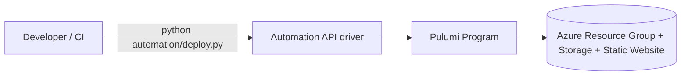

# Pulumi Automation API Azure Platform Experiment

This repository is a Python-based infrastructure project that demonstrates managing Azure resources with the Pulumi Automation API, driven from a Python script.

The project provisions a small Azure baseline (Resource Group + Storage Account + Static Website) through a reusable Pulumi component, enables static website hosting on that storage account.

## Table of Contents

- [Pulumi Automation API Azure Platform Experiment](#pulumi-automation-api-azure-platform-experiment)
	- [Table of Contents](#table-of-contents)
	- [What This Repository Does](#what-this-repository-does)
	- [Architecture](#architecture)
		- [Architecture Diagram](#architecture-diagram)
		- [Core Pulumi Component](#core-pulumi-component)
		- [Pulumi Program](#pulumi-program)
		- [Automation API Driver](#automation-api-driver)
	- [Repository Layout](#repository-layout)
	- [Prerequisites](#prerequisites)
	- [Setup](#setup)
	- [CI/CD with GitHub Actions](#cicd-with-github-actions)
		- [Setup the workflow in GitHub](#setup-the-workflow-in-github)
		- [Required GitHub repository secrets](#required-github-repository-secrets)
	- [Local Deployment (Automation API)](#local-deployment-automation-api)
		- [How to Update Website Content](#how-to-update-website-content)
		- [Troubleshooting Local Deployment](#troubleshooting-local-deployment)
	- [Configuration](#configuration)
	- [Setting the state backend](#setting-the-state-backend)
	- [Testing](#testing)
	- [Current State and Limitations](#current-state-and-limitations)
	- [Why This Repo Is Useful](#why-this-repo-is-useful)

## What This Repository Does

At a high level:

1. Defines an `AzurePlatform` component in `components/azure_platform.py`.
2. Uses that component in `pulumi_program/__main__.py` to create:
	 - an Azure Resource Group
	 - an Azure Storage Account
	 - a Storage static website endpoint with a sample `index.html`
3. Exposes an Automation API entrypoint in `automation/deploy.py` that creates/selects a stack and runs `stack.up()`.

## Architecture

### Architecture Diagram



### Core Pulumi Component

`components/azure_platform.py`

- Implements `AzurePlatform` as a `pulumi.ComponentResource`.
- Creates:
	- `azure.resources.ResourceGroup` named `<name>-rg`
	- `azure.storage.StorageAccount` for infra and website hosting
	- `azure.storage.StorageAccountStaticWebsite` (`index.html` / `404`)
	- `azure.storage.Blob` upload of `website/index.html` into `$web`
- Registers outputs `resourceGroup`, `storageAccountName`, and `websiteUrl`.

### Pulumi Program

`pulumi_program/__main__.py`

- Reads `azure-native:location`.
- Falls back to `westeurope` if not set.
- Instantiates `AzurePlatform("demo-platform", location=...)`.
- Exports `platformName` and `websiteUrl`.

### Automation API Driver

`automation/deploy.py`

- Uses `pulumi.automation.create_or_select_stack`.
- Stack name: `dev`.
- Project name: `azure-automation-api` (matches `Pulumi.yaml`).
- Program callback imports `pulumi_program.__main__`.
- Installs `azure-native` plugin version `v3.15.0`.
- Sets config `azure-native:location=westeurope`.
- Runs `stack.up()` and streams output.

## Repository Layout

```text
automation/
	deploy.py                  # Automation API deployment entrypoint
components/
	azure_platform.py          # Reusable Pulumi component (RG + Storage)
pulumi_program/
	__main__.py                # Pulumi program run by the Automation API
tests/
	test_component.py          # Basic component instantiation test
website/
	index.html                 # Sample static website page uploaded to $web
```

## Prerequisites

- Python 3.10+
- Azure credentials configured (for real deployments)
- Pulumi CLI
- `pip`

## Setup

```bash
python -m venv .venv
source .venv/bin/activate
pip install -r requirements.txt
```

## CI/CD with GitHub Actions

This repository now includes a workflow at `.github/workflows/ci-cd.yml`.

### Setup the workflow in GitHub

1. Push this repository (including `.github/workflows/ci-cd.yml`) to GitHub.
2. Open the repository in GitHub and go to `Settings` -> `Secrets and variables` -> `Actions`.
3. Under `Repository secrets`, add all required secrets listed below.
4. Go to the `Actions` tab and confirm workflows are enabled for the repository.
5. Trigger CI by opening a pull request to `main`.
6. Trigger CD by merging/pushing to `main`.
7. Optionally trigger manually from `Actions` -> `CI-CD` -> `Run workflow`.

Verification:

- PR run should execute only the `Test` job.
- Push to `main` should execute `Test` and then `Deploy`.
- In a successful deploy run, you should see `Deploying stack...` in logs.

Behavior:

- On `pull_request` to `main`: run test job (`pytest`).
- On `push` to `main`: run tests, then deploy with `python automation/deploy.py`.
- Supports manual run via `workflow_dispatch`.

### Required GitHub repository secrets

Add these in `Settings` -> `Secrets and variables` -> `Actions`:

- `PULUMI_CONFIG_PASSPHRASE`: passphrase used by the stack secrets manager.
- `PULUMI_BACKEND_URL`: backend URL (for example `azblob://state`).
- `AZURE_STORAGE_ACCOUNT`: storage account used by the Azure Blob Pulumi backend.
- `AZURE_STORAGE_KEY`: storage key for that account.
- `ARM_CLIENT_ID`: Azure service principal client ID.
- `ARM_CLIENT_SECRET`: Azure service principal client secret.
- `ARM_TENANT_ID`: Azure tenant ID.
- `ARM_SUBSCRIPTION_ID`: Azure subscription ID.

Where to get Azure values:

- `ARM_SUBSCRIPTION_ID`: Azure Portal -> `Subscriptions` -> `<your subscription>` -> `Subscription ID`.
- `ARM_TENANT_ID`: Azure Portal -> `Microsoft Entra ID` -> `Overview` -> `Tenant ID`.
- `ARM_CLIENT_ID`: Azure Portal -> `Microsoft Entra ID` -> `App registrations` -> `<your app>` -> `Application (client) ID`.
- `ARM_CLIENT_SECRET`: Azure Portal -> `App registrations` -> `<your app>` -> `Certificates & secrets` -> create a new client secret and copy `Value`.

If you are not using an Azure Blob backend, you can omit `PULUMI_BACKEND_URL`, `AZURE_STORAGE_ACCOUNT`, and `AZURE_STORAGE_KEY`, and use your preferred Pulumi backend login strategy.

## Local Deployment (Automation API)

Run the Python automation driver:

```bash
python automation/deploy.py
```

What this does:

1. Creates or selects stack `dev`.
2. Installs Pulumi Azure Native plugin.
3. Sets stack config.
4. Executes deployment.

After deployment, get the static website endpoint:

```bash
pulumi stack output websiteUrl
```

Then open the URL in your browser.

### How to Update Website Content

1. Edit `website/index.html`.
2. Re-run the deployment:

```bash
python automation/deploy.py
```

3. Refresh the website URL in your browser.

Optional verification:

```bash
pulumi preview
```

If `website/index.html` changed, preview should show an update to the `azure-native:storage:Blob` resource for `index.html`.

### Troubleshooting Local Deployment

If first run fails with `no stack named 'dev' found`, that part is expected while Pulumi tries to create the stack.

If it then fails with `passphrase must be set`, configure one of the following before running `python automation/deploy.py`:

```bash
export PULUMI_CONFIG_PASSPHRASE='<your-strong-passphrase>'
```

Or use a file-based passphrase:

```bash
printf '%s' '<your-strong-passphrase>' > ~/.pulumi-passphrase
chmod 600 ~/.pulumi-passphrase
export PULUMI_CONFIG_PASSPHRASE_FILE=~/.pulumi-passphrase
```

Notes:

- Keep the same passphrase for future runs so Pulumi can decrypt stack secrets.
- If you are using an Azure Blob backend (`azblob://...`), also ensure backend variables are set (for example `AZURE_STORAGE_ACCOUNT` and either `AZURE_STORAGE_KEY` or `AZURE_STORAGE_SAS_TOKEN`).

## Configuration

Current config files:

- `Pulumi.yaml`
- `Pulumi.dev.yaml`

Important detail:

- `pulumi_program/__main__.py` reads `azure-native:location`.
- `automation/deploy.py` and `Pulumi.dev.yaml` set `azure-native:location`.

This keeps local Automation API and stack configuration consistent.

## Setting the state backend

```bash


# 1) Set backend storage account info
export AZURE_STORAGE_ACCOUNT=<your-storage-account-name>
export AZURE_STORAGE_KEY=$(az storage account keys list --account-name $AZURE_STORAGE_ACCOUNT --query '[0].value' -o tsv)
# (or use AZURE_STORAGE_SAS_TOKEN instead of key)

# 2) Ensure backend is selected
pulumi login azblob://state

# 3) Verify backend is reachable
pulumi whoami

# 4) Run deploy from repo root
cd /home/rodrigo/Repos/pulumi-automation-api
python automation/deploy.py
```

## Testing

Run tests with:

```bash
./.venv/bin/python -m pytest
```

If your shell is already inside the virtualenv, `pytest` also works.

Current test coverage is minimal and only checks component instantiation.

## Current State and Limitations

- There is no root-level Pulumi `__main__.py`; this repo currently relies on the automation script and `pulumi_program/` directory pattern.

## Why This Repo Is Useful

This project is a good starting point for teams that want to:

- encapsulate Azure infrastructure in reusable Pulumi components,
- trigger deployments programmatically from Python (Automation API), and
- run the same deployment flow locally or from CI.